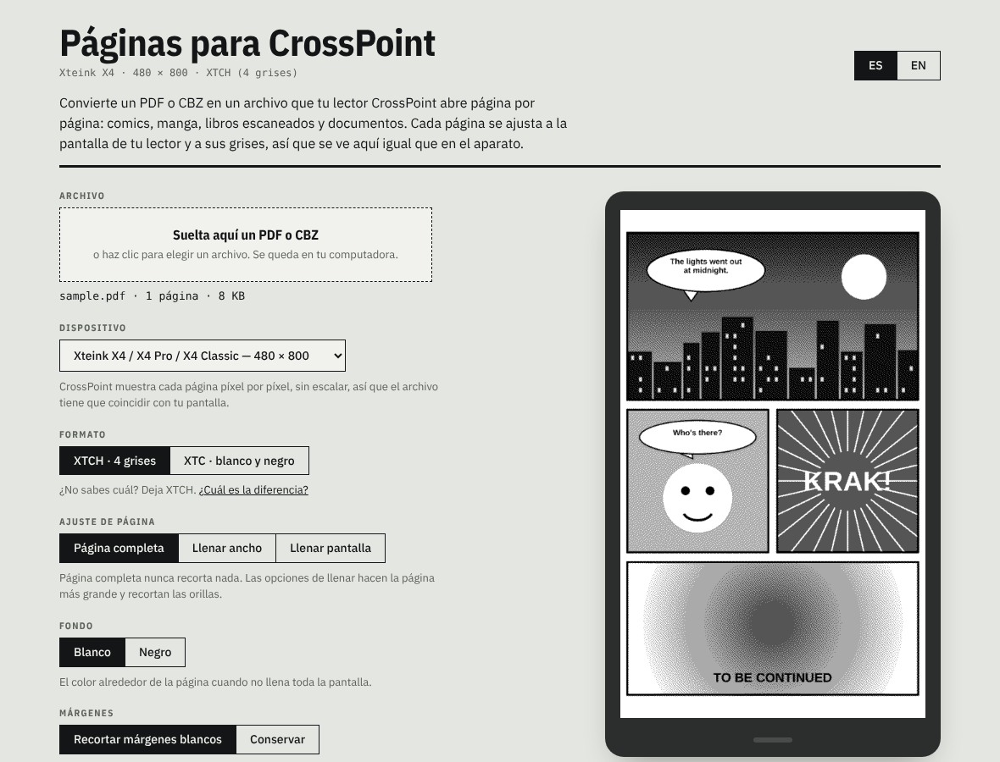

# Páginas para CrossPoint

Convierte un PDF o CBZ en un archivo que tu lector [CrossPoint Reader](https://crosspointreader.com/) abre página por página: comics, manga, libros escaneados y documentos.

**Úsalo aquí: [aendom.github.io/crosspoint-pages](https://aendom.github.io/crosspoint-pages/)**

*[Read in English](README.md)*

## Qué hace

Le das un PDF o un CBZ. Convierte cada página en una imagen del tamaño exacto de la pantalla de tu lector, la lleva a los grises que esa pantalla puede mostrar y junta todas las páginas en un solo archivo **XTCH** o **XTC**. CrossPoint lo abre como un libro y pasa las páginas al instante, porque cada una ya está dibujada.

No convierte el texto en un libro electrónico reajustable. Si tienes un EPUB o un PDF con mucho texto que prefieres leer con tamaño de letra ajustable, usa EPUB. Esta herramienta es para páginas que deben verse como fueron diseñadas: comics, manga, libros ilustrados, escaneos, partituras, formularios.

Todo corre en tu navegador. El archivo nunca se sube a ningún lado; no hay servidor, cuenta ni nada que instalar.

## Cómo usarlo

1. Suelta un PDF o CBZ en la página.
2. Elige tu **dispositivo**. La vista previa muestra exactamente los píxeles que verás en el lector.
3. Elige las opciones de abajo y revisa algunas páginas con las flechas. El tamaño del archivo final aparece arriba del botón antes de convertir.
4. Presiona **Convertir y descargar**.
5. Copia el archivo a la tarjeta SD, por ejemplo a una carpeta `/comics`, y ábrelo desde **Browse Files** en el lector.

## Dispositivos

CrossPoint dibuja cada página píxel por píxel, sin escalar, así que el archivo tiene que coincidir con la pantalla. Los tamaños vienen del firmware de CrossPoint y de su SDK de pantallas:

| Dispositivo | Tamaño (vertical) |
|---|---|
| Xteink X4 / X4 Pro / X4 Classic | 480 × 800 |
| Xteink X3 | 528 × 792 |
| M5 PaperMono / PaperMono Lite | 480 × 800 |
| Seeed reTerminal Sticky | 480 × 800 |
| Boox Picco | 480 × 800 |
| Metalio E-Ink 4 | 480 × 800 |
| EEGOREAD A4 | 552 × 768 |
| Personalizado | cualquier tamaño de 100 a 2048 px |

## Opciones

- **Formato:** XTCH (4 grises) o XTC (blanco y negro). Ver abajo.
- **Ajuste de página:** *Página completa* nunca recorta nada. *Llenar ancho* y *Llenar pantalla* hacen la página más grande y recortan las orillas.
- **Fondo:** blanco o negro, para el espacio alrededor de la página cuando no llena la pantalla.
- **Márgenes:** *Recortar márgenes blancos* quita el borde vacío de cada página para que el dibujo se vea más grande en la pantalla chica.
- **Páginas anchas:** para páginas dobles. *Rotar* las acuesta para llenar la pantalla; *Partir en dos* las convierte en dos páginas.
- **Sentido de lectura:** izquierda a derecha, o derecha a izquierda para manga. Define el orden de las páginas partidas.
- **Título en el lector:** el nombre que CrossPoint muestra en su biblioteca.

## ¿XTCH o XTC?

Los dos son formatos propios de CrossPoint: cada página se guarda lista para mostrarse.

| | XTCH · 4 grises (recomendado) | XTC · blanco y negro |
|---|---|---|
| Tonos por píxel | blanco, gris claro, gris oscuro, negro | negro o blanco; los grises se vuelven un patrón de puntos fino |
| Se ve mejor en | sombras, tramas, fotos, escaneos | dibujo de línea, texto, comics de alto contraste |
| Tamaño en pantalla de 480 × 800 | unos 94 KB por página | unos 47 KB por página |
| Cambio de página | un poco más lento | más rápido |

## Archivos grandes

Archivos de 100 MB o más se convierten sin problema en una computadora: las páginas se procesan una por una, así que el uso de memoria se mantiene bajo. En las pruebas, un PDF escaneado de 172 MB y 60 páginas se convirtió en unos 30 segundos. En un celular, sobre todo en iPhone, el navegador puede quedarse sin memoria con archivos grandes; para esos usa una computadora.

## Cómo se preparan las páginas

1. Cada página se renderiza a unas 2.5 veces el tamaño de la pantalla (los PDF con [pdf.js](https://mozilla.github.io/pdf.js/), las imágenes del CBZ tal como vienen).
2. Se recortan los márgenes blancos, las páginas anchas se rotan o se parten, y la página se ajusta a la pantalla.
3. Un ajuste automático de niveles lleva el tono del papel a blanco limpio, para que los escaneos en papel amarillento no se llenen de puntos.
4. El [tramado Atkinson](https://en.wikipedia.org/wiki/Atkinson_dithering) reduce la página a 4 grises o a blanco y negro.
5. Las páginas se escriben con la estructura que espera el lector de CrossPoint (`lib/Xtc` y `XtcReaderActivity` en el firmware).

## Úsalo por tu cuenta

Todo el convertidor es `index.html` más la carpeta `fonts/`. Ábrelo en cualquier navegador, o haz un fork de este repo y activa GitHub Pages (**Settings → Pages → Deploy from a branch → `main` / root**).

## Licencia

MIT. Las fuentes en `fonts/` (IBM Plex) están bajo la SIL Open Font License. pdf.js (Apache 2.0) y JSZip (MIT) se cargan desde cdnjs.

Sin relación oficial con el proyecto CrossPoint Reader. Proyecto hermano de [CrossPoint Calendar](https://github.com/aendom/crosspoint-calendar).
