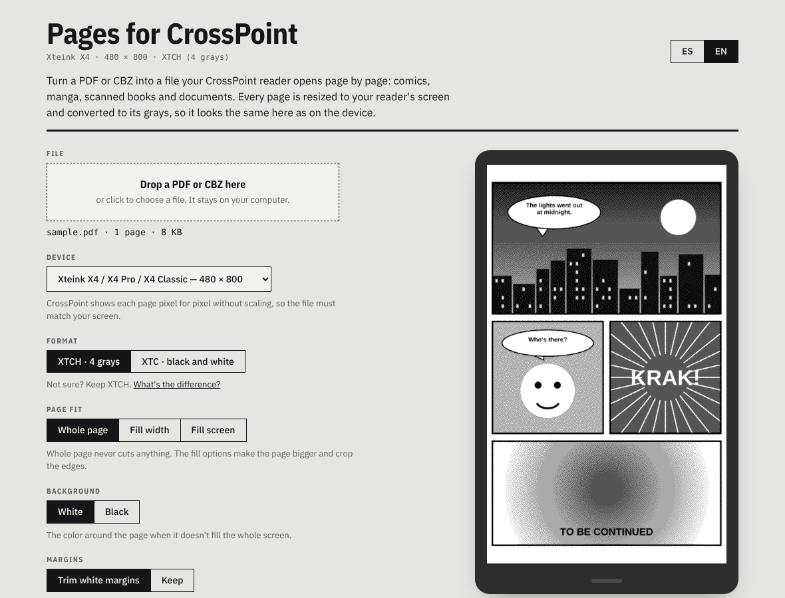

# Pages for CrossPoint

Turn a PDF or CBZ into a file your [CrossPoint Reader](https://crosspointreader.com/) opens page by page: comics, manga, scanned books and documents.

**Use it here: [aendom.github.io/crosspoint-pages](https://aendom.github.io/crosspoint-pages/)**

*[Leer en español](README.es.md)*

## What it does

You give it a PDF or a CBZ. It turns every page into an image sized exactly for your reader's screen, converts it to the grays the screen can show, and packs all the pages into one **XTCH** or **XTC** file. CrossPoint opens that file like a book and turns pages instantly, because each page is already drawn.

It doesn't convert text into a reflowable ebook. If you have an EPUB or a text-heavy PDF you'd rather read with adjustable font size, use EPUB instead. This tool is for pages that should look the way they were designed: comics, manga, illustrated books, scans, sheet music, forms.

Everything runs in your browser. The file is never uploaded, and there is no server, no account and nothing to install.

## How to use it

1. Drop a PDF or CBZ on the page.
2. Pick your **device**. The preview shows the exact pixels your reader will display.
3. Choose the options below and check a few pages with the arrows. The final file size shows above the button before you convert.
4. **Convert and download**.
5. Copy the file to the SD card, for example to a `/comics` folder, and open it from **Browse Files** on the reader.

## Devices

CrossPoint draws each page pixel for pixel without scaling, so the file has to match the screen. Sizes come from the CrossPoint firmware and its display SDK:

| Device | Size (portrait) |
|---|---|
| Xteink X4 / X4 Pro / X4 Classic | 480 × 800 |
| Xteink X3 | 528 × 792 |
| M5 PaperMono / PaperMono Lite | 480 × 800 |
| Seeed reTerminal Sticky | 480 × 800 |
| Boox Picco | 480 × 800 |
| Metalio E-Ink 4 | 480 × 800 |
| EEGOREAD A4 | 552 × 768 |
| Custom | any size from 100 to 2048 px |

## Options

- **Format:** XTCH (4 grays) or XTC (black and white). See below.
- **Page fit:** *Whole page* never cuts anything. *Fill width* and *Fill screen* make the page bigger and crop the edges.
- **Background:** white or black, for the space around the page when it doesn't fill the screen.
- **Margins:** *Trim white margins* removes the empty border around each page so the art is larger on the small screen.
- **Wide pages:** for double-page spreads. *Rotate* turns them sideways to fill the screen; *Split in two* makes two pages.
- **Reading direction:** left to right, or right to left for manga. It sets the order of split pages.
- **Title on the reader:** the name CrossPoint shows in its library.

## XTCH or XTC?

Both are CrossPoint's own page formats: each page is stored ready to display.

| | XTCH · 4 grays (recommended) | XTC · black and white |
|---|---|---|
| Shades per pixel | white, light gray, dark gray, black | black or white; grays become a fine dot pattern |
| Looks best for | shading, screentones, photos, scans | line art, text, high-contrast comics |
| Size on a 480 × 800 screen | about 94 KB per page | about 47 KB per page |
| Page turns | a moment slower | faster |

## Large files

Files of 100 MB or more convert fine on a computer: pages are processed one at a time, so memory use stays low. A 172 MB, 60-page scanned PDF converted in about 30 seconds in testing. On a phone, especially an iPhone, the browser may run out of memory with large files, so use a computer for those.

## How the pages are prepared

1. Each page is rendered at about 2.5× the screen size (PDF with [pdf.js](https://mozilla.github.io/pdf.js/), CBZ images as they are).
2. White margins are trimmed, wide pages are rotated or split, and the page is fitted to the screen.
3. Automatic levels take the paper tone to clean white, so scans on off-white paper don't fill with dots.
4. [Atkinson dithering](https://en.wikipedia.org/wiki/Atkinson_dithering) reduces the page to 4 grays or black and white.
5. The pages are written in the layout CrossPoint's own reader expects (`lib/Xtc` and `XtcReaderActivity` in the firmware).

## Run it yourself

The whole converter is `index.html` plus the `fonts/` folder. Open it in any browser, or fork this repo and turn on GitHub Pages (**Settings → Pages → Deploy from a branch → `main` / root**).

## License

MIT. The fonts in `fonts/` (IBM Plex) are under the SIL Open Font License. pdf.js (Apache 2.0) and JSZip (MIT) load from cdnjs.

Not affiliated with the CrossPoint Reader project. Sibling of [CrossPoint Calendar](https://github.com/aendom/crosspoint-calendar).
